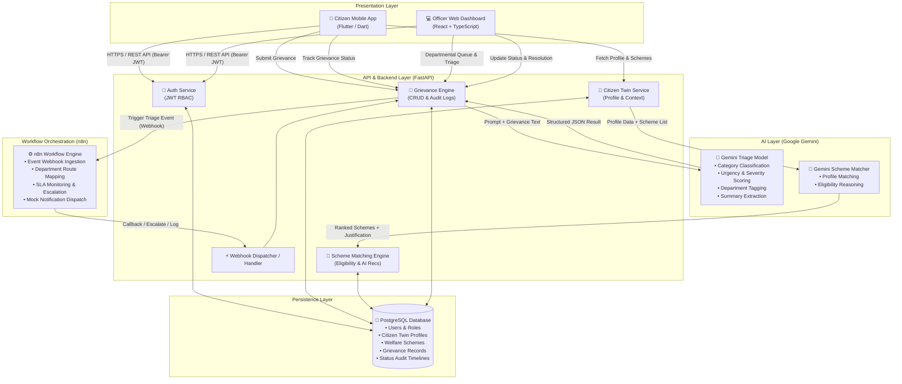
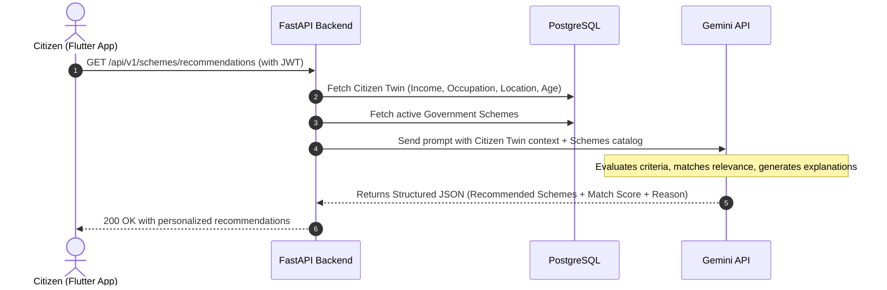
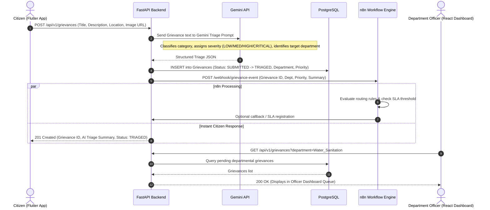
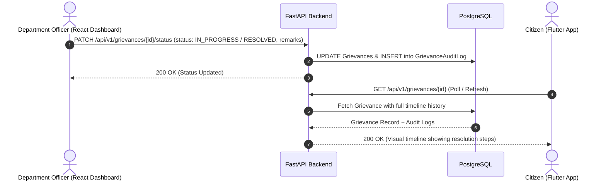

# CivicOS Architecture Specification 📐

## 1. Executive Architecture Summary

CivicOS is architected as a modular, event-driven civic-tech platform. It bridges citizens with government department officers through an AI-powered intelligence layer (Google Gemini) and a low-code workflow automation orchestrator (n8n), backed by a high-performance Python FastAPI service and PostgreSQL database.

---

## 2. High-Level System Architecture



---

## 3. Data Flow & Sequence Diagrams

### 3.1 Flow A: Citizen Profile & AI Scheme Recommendations



### 3.2 Flow B: Grievance Submission, AI Triage & n8n Orchestration



### 3.3 Flow C: Officer Resolution & Status Propagation



---

## 4. Component Modular Design

```text
CivicOS/
├── backend/
│   ├── app/
│   │   ├── api/
│   │   │   ├── v1/
│   │   │   │   ├── auth.py          # Login, Register, Me
│   │   │   │   ├── citizens.py      # Citizen Twin profile management
│   │   │   │   ├── schemes.py       # Schemes and AI recommendation endpoints
│   │   │   │   ├── grievances.py   # Grievance CRUD, triage, and status updates
│   │   │   │   └── webhooks.py      # n8n webhook receiver & callbacks
│   │   │   └── router.py            # Aggregated v1 API router
│   │   ├── core/
│   │   │   ├── config.py            # Environment variables & application settings
│   │   │   ├── database.py          # SQLAlchemy / asyncpg engine & sessionmaker
│   │   │   └── security.py          # JWT creation, password hashing, OAuth2 dependencies
│   │   ├── models/                  # SQLAlchemy ORM database models
│   │   │   ├── user.py              # User & Role models
│   │   │   ├── citizen_twin.py      # Demographic & socio-economic profile
│   │   │   ├── scheme.py            # Welfare scheme metadata
│   │   │   └── grievance.py         # Grievance, AI triage data, and timeline logs
│   │   ├── schemas/                 # Pydantic v2 schemas for validation & serialization
│   │   │   ├── user.py
│   │   │   ├── citizen_twin.py
│   │   │   ├── scheme.py
│   │   │   └── grievance.py
│   │   ├── services/                # Business logic & 3rd-party integrations
│   │   │   ├── gemini_service.py    # Google Gemini client (Triage & Recommendations)
│   │   │   ├── n8n_service.py       # n8n webhook trigger client
│   │   │   └── seed_data.py         # Pre-loaded hackathon demo fixtures
│   │   └── main.py                  # FastAPI application entrypoint
│   ├── requirements.txt
│   └── Dockerfile
├── citizen-app/                     # Flutter Mobile App (Dart)
├── officer-dashboard/               # React + TypeScript + Vite + Tailwind
└── n8n/                             # Workflow JSON exports & trigger configs
```

---

## 5. Intelligence Layer (Google Gemini Integration)

### 5.1 Grievance Triage Prompt Contract
- **Input**: Grievance title, description, location, category tag (if provided by user).
- **Output (Structured JSON Schema)**:
```json
{
  "category": "Roads & Infrastructure | Water & Sanitation | Electricity & Energy | Public Health | Waste Management",
  "assigned_department": "Public_Works | Water_Sanitation | Electricity_Board | Health_Dept | Municipal_Corp",
  "priority": "LOW | MEDIUM | HIGH | CRITICAL",
  "urgency_score": 0.85,
  "summary": "Concise 1-2 sentence executive summary of the issue",
  "suggested_initial_action": "Immediate on-site inspection for pipe burst",
  "key_entities": ["4th Cross Main Road", "water pipe", "flooding"]
}
```

### 5.2 Scheme Recommendation Prompt Contract
- **Input**: Citizen Twin (Age, Occupation, Annual Income, Urban/Rural, Gender, Caste/Category, Family Size) + JSON List of available government schemes.
- **Output (Structured JSON Schema)**:
```json
{
  "recommendations": [
    {
      "scheme_id": "SCH_001",
      "scheme_name": "Pradhan Mantri Solar Subsidy",
      "match_confidence": 0.95,
      "eligibility_reasons": ["Homeowner in urban area", "Income within eligible tier"],
      "potential_benefit": "Up to 40% subsidy on rooftop solar installation"
    }
  ]
}
```

---

## 6. Automation Layer (n8n Workflow Integration)

1. **Trigger**: Backend dispatches a `POST` request to n8n webhook URL upon grievance creation and triage completion.
2. **Payload**:
   ```json
   {
     "event": "GRIEVANCE_TRIAGED",
     "grievance_id": "grv_8921f92",
     "department": "Water_Sanitation",
     "priority": "HIGH",
     "title": "Broken water main flooding road",
     "citizen_id": "usr_c01",
     "timestamp": "2026-08-24T14:50:00Z"
   }
   ```
3. **n8n Actions**:
   - Routes task to the specific departmental queue.
   - Evaluates SLA timer (e.g. Critical = 4h, High = 24h).
   - Generates simulated alert (e.g. Webhook, Email, or Slack/Discord mock channel).

---

## 7. Role-Based Access Control (RBAC) Matrix

| Resource / Action | Citizen | Department Officer | Admin |
|---|---|---|---|
| Register / Login | ✅ | ✅ | ✅ |
| View / Edit Own Citizen Twin | ✅ | ❌ | ✅ |
| Request Scheme Recommendations | ✅ | ❌ | ✅ |
| Submit New Grievance | ✅ | ❌ | ✅ |
| View Own Grievances | ✅ | ❌ | ✅ |
| View Department Grievance Queue | ❌ | ✅ (Assigned Dept only) | ✅ (All Depts) |
| Update Grievance Status & Remarks | ❌ | ✅ | ✅ |
| Access Metrics / SLA Stats | ❌ | ✅ | ✅ |

---

## 8. Modularity & Independent Development

To enable rapid solo hackathon development, each component is decoupled via strict contracts:
1. **Mock AI Service Mode**: If `GEMINI_API_KEY` is not provided during offline dev, `gemini_service.py` falls back to deterministic rule-based triage.
2. **Mock n8n Webhook Mode**: If n8n is not running, FastAPI gracefully logs the webhook payload without blocking grievance creation.
3. **Seed Data Autoload**: Database can be seeded with one command with realistic citizens, officers, schemes, and grievances for immediate demo testing.
